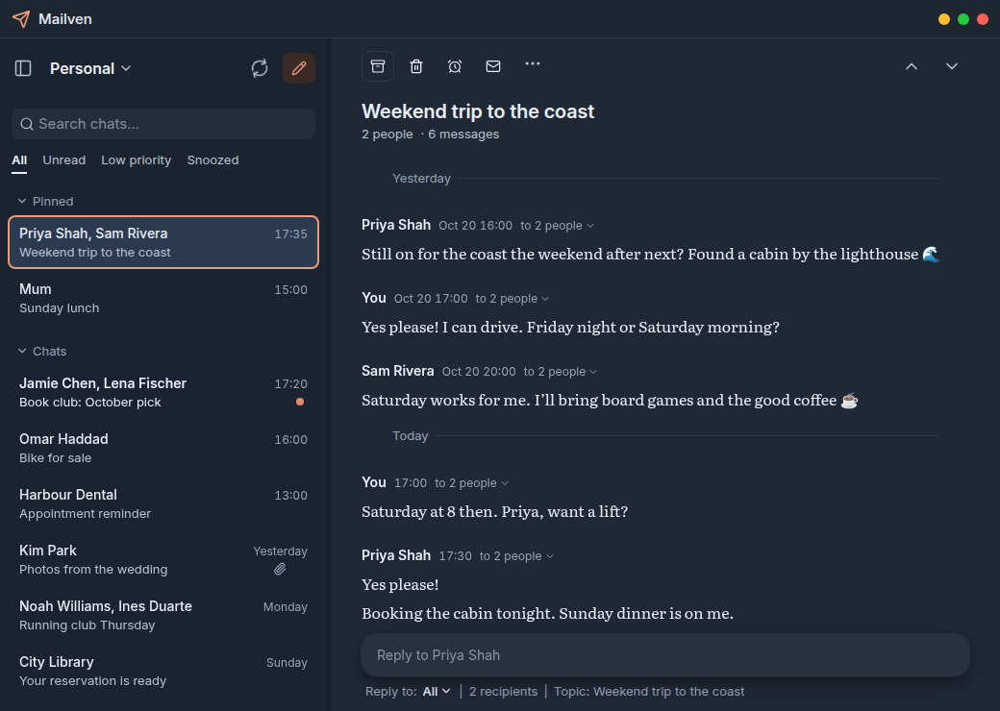
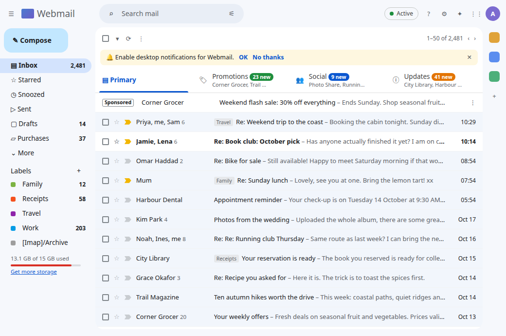
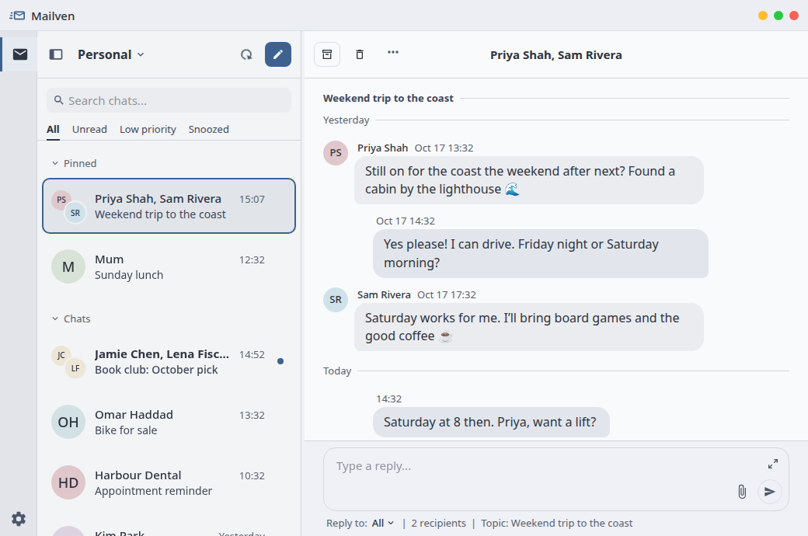
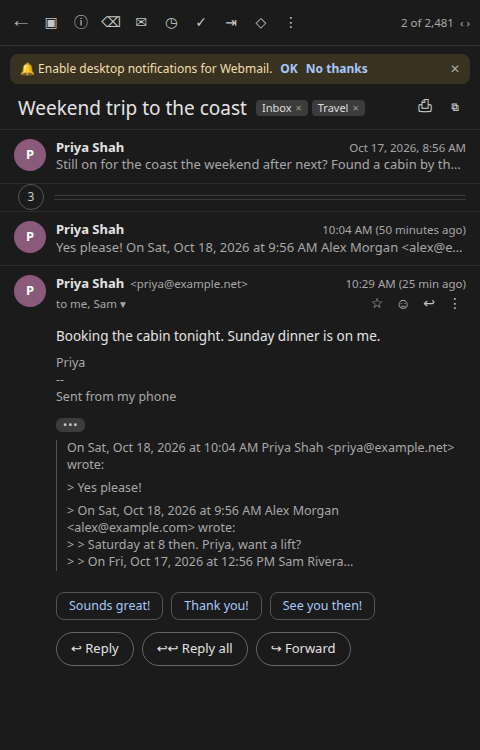
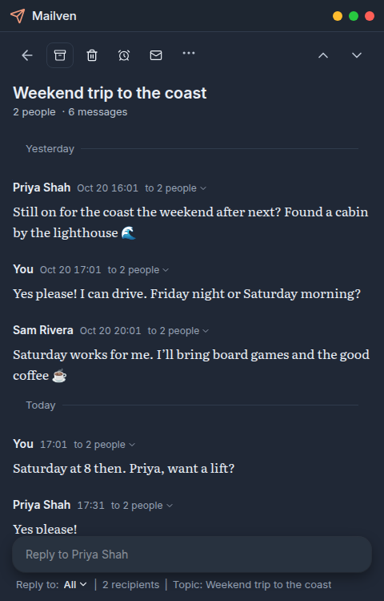

# Mailven | _Email, reimagined as chat_

## Overview

**Mailven** is a Messenger-style email client. It simplifies your inbox by turning emails into chats with the clutter removed.

| A typical cluttered webmail inbox | The same mail in Mailven |
| --- | --- |
|  |  |

| A typical webmail thread | The same thread in Mailven |
| --- | --- |
|  |  |

_Note_: this is a personal project that is alpha software under active development. User-caution is heavily emphasized, no guarantees or warranties provided. 

## History

Mailven started with the desire for a simple chat interface for email, similar to the way that [Beeper](https://www.beeper.com/) has done for messenger apps. Unfortunately, no such solutuion existed.

Mailven is a custom fork of the open-source [**Aerion email client**](https://github.com/hkdb/aerion), with the goal of transforming it into an email chat app. While Mailven has diverged into its own project, its existence wouldn't be possible without all of the hard work by the Aerion team.

## Features

Mailven aims to present your emails as chats, similar to instant messaging apps like Messages, WhatsApp, etc. The goal is to reduce the information overload that contemporary email has become:

- Emails are grouped by _sender_, not _subject_.
  - This allows multiple threads to appear as a single chat.
- Message clutter (signatures, quoted text, HTML styling) is hidden by default.
- Newsletters and notifications are automatically marked as "Low priority".
- Chats can be pinned and snoozed.

See [Email Management](docs/user-guide/features/email-management.md#chat-mail) for details.

## Installation

There are no published releases yet. Build from source with the [Build Guide](docs/BUILD.md), or follow the [Installation Guide](docs/user-guide/getting-started/installation/index.md) for build-from-source and local Flatpak steps on each platform.

## Documentation

- [User Guide](docs/user-guide/intro.md)
- [Providers and account requirements](docs/PROVIDERS.md)
- [Sending and recovery](docs/SENDING.md)
- [Build Guide](docs/BUILD.md)
- [Release process](docs/RELEASE.md)
- [Changelog](CHANGELOG.md)

## Contributing

Please see [CONTRIBUTING.md](CONTRIBUTING.md). Report vulnerabilities according to [SECURITY.md](SECURITY.md).

## License

Mailven is licensed under the Apache License 2.0. 

**Legal:** [Disclaimer](DISCLAIMER.md) · [NOTICE](NOTICE) · [Third-Party Notices](THIRD_PARTY_NOTICES.md) · [License](LICENSE) (Apache-2.0)

